# Amazon Prime Clone Deployment Project

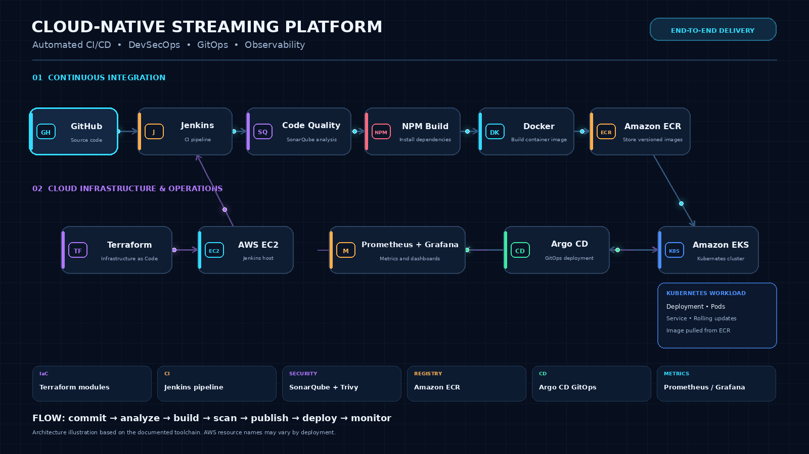

## Table of Contents
- [Project Overview](#project-overview)
- [Pre-requisites](#pre-requisites)
- [Configuration](#configuration)
- [Infrastructure Setup Using Terraform](#infrastructure-setup-using-terraform)
- [SonarQube Configuration](#sonarqube-configuration)
- [Jenkins Configuration](#jenkins-configuration)
- [Pipeline Overview](#pipeline-overview)
- [Continuous Deployment with ArgoCD](#continuous-deployment-with-argocd)
- [Application Output](#application-output)
- [Monitoring with Prometheus & Grafana](#monitoring-with-prometheus--grafana)
- [Cleanup](#cleanup)
- [Additional Information](#additional-information)

## Project Overview
This project demonstrates deploying an Amazon Prime clone using a set of DevOps tools and practices. The primary tools include:

- **Terraform**: Infrastructure as Code (IaC) tool to create AWS infrastructure such as EC2 instances and EKS clusters.
- **GitHub**: Source code management.
- **Jenkins**: CI/CD automation tool.
- **SonarQube**: Code quality analysis and quality gate tool.
- **NPM**: Build tool for NodeJS.
- **Aqua Trivy**: Security vulnerability scanner.
- **Docker**: Containerization tool to create images.
- **AWS ECR**: Repository to store Docker images.
- **AWS EKS**: Container management platform.
- **ArgoCD**: Continuous deployment tool.
- **Prometheus & Grafana**: Monitoring and alerting tools.

## Pre-requisites
1. **AWS Account**: Ensure you have an AWS account. [Create an AWS Account](https://docs.aws.amazon.com/accounts/latest/reference/manage-acct-creating.html)
2. **AWS CLI**: Install AWS CLI on your local machine. [AWS CLI Installation Guide](https://docs.aws.amazon.com/cli/latest/userguide/getting-started-install.html)
3. **VS Code (Optional)**: Download and install VS Code as a code editor. [VS Code Download](https://code.visualstudio.com/download)
4. **Terraform on Windows**: Download and install Terraform. [Terraform in Windows](https://learn.microsoft.com/en-us/azure/developer/terraform/get-started-windows-bash)

## Configuration
### AWS Setup
1. **IAM User**: Create an IAM user and generate the access and secret keys to configure your machine with AWS.
2. **Key Pair**: Create a key pair named `key` for accessing your EC2 instances.

## Infrastructure Setup Using Terraform
1. **Clone the Repository** (open Command Prompt and run the commands below):
   ```bash
   git clone https://github.com/pandacloud1/DevopsProject2.git
   cd DevopsProject2
   code .   # opens the project in VS Code
   ```
2. **Initialize and Apply Terraform**:
   - (Optional) Shorten the path shown in the VS Code terminal:
     ```bash
     code $PROFILE
     function prompt {"$PWD > "}
     function prompt {$(Get-Location -Leaf) + " > "}
     ```
   - Open `terraform_code/ec2_server/main.tf` in VS Code.
   - Run the following commands:
     ```bash
     aws configure
     terraform init
     terraform apply --auto-approve
     ```

This creates the EC2 instance, security groups, and installs the necessary tools (Jenkins, Docker, SonarQube, etc.).

**Proof – Terraform / EC2 setup:**

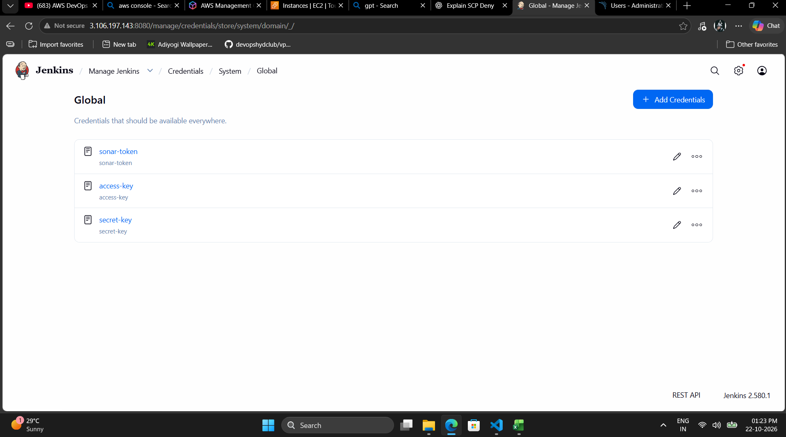

## SonarQube Configuration
1. **Login Credentials**: Use `admin` for both username and password (change the password on first login).
2. **Generate SonarQube Token**:
   - Create a token under `Administration → Security → Users → Tokens`.
   - Save the token for integration with Jenkins.

**Proof – SonarQube login and token:**

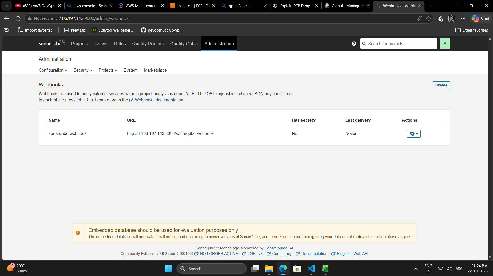
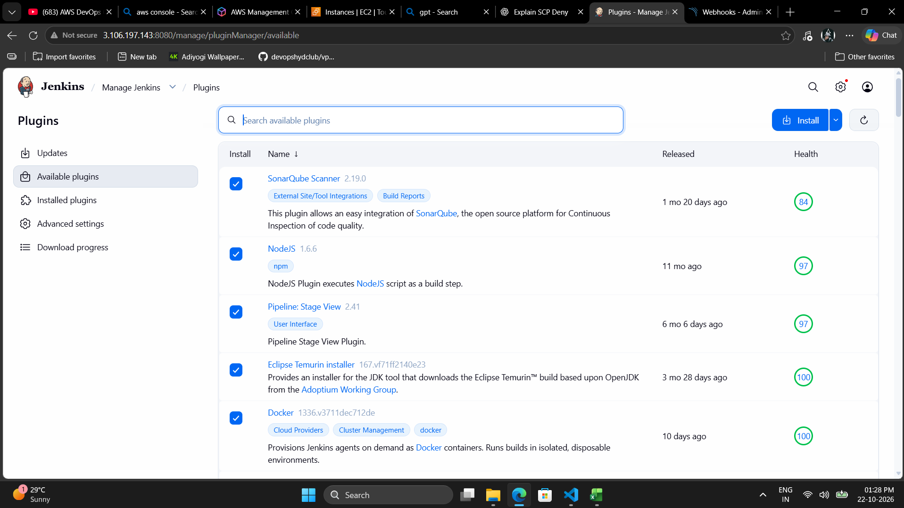

## Jenkins Configuration
1. **Add Jenkins Credentials**:
   - Add the SonarQube token, AWS access key, and secret key in `Manage Jenkins → Credentials → System → Global credentials`.
2. **Install Required Plugins**:
   - Install plugins such as SonarQube Scanner, NodeJS, Docker, and Prometheus metrics under `Manage Jenkins → Plugins`.
3. **Global Tool Configuration**:
   - Set up tools like JDK 17, SonarQube Scanner, NodeJS, and Docker under `Manage Jenkins → Global Tool Configuration`.

**Proof – Jenkins credentials, plugins and tools:**

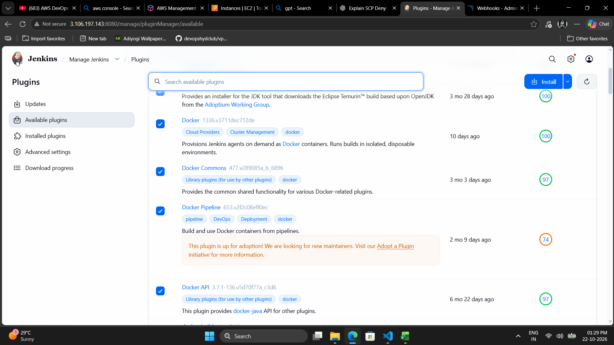
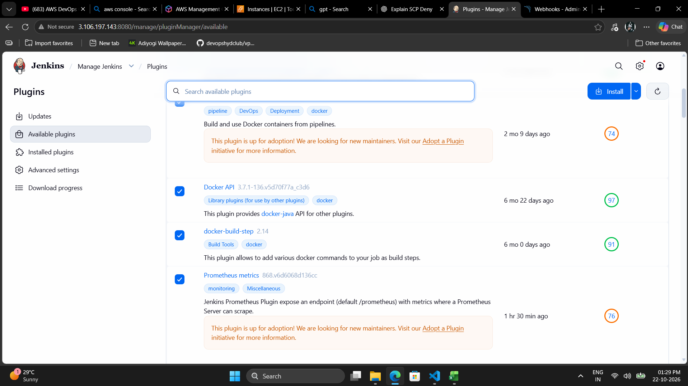
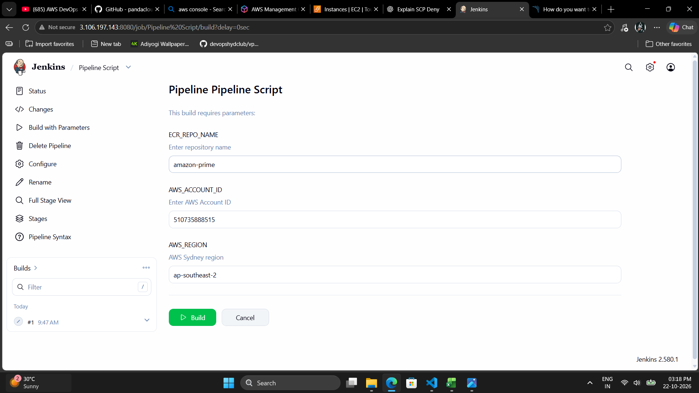

## Pipeline Overview
### Pipeline Stages
1. **Git Checkout**: Clones the source code from GitHub.
2. **SonarQube Analysis**: Performs static code analysis.
3. **Quality Gate**: Ensures code quality standards.
4. **Install NPM Dependencies**: Installs NodeJS packages.
5. **Trivy Security Scan**: Scans the project for vulnerabilities.
6. **Docker Build**: Builds a Docker image for the project.
7. **Push to AWS ECR**: Tags and pushes the Docker image to ECR.
8. **Image Cleanup**: Deletes images from the Jenkins server to save space.

The full CI script lives in the [`pipeline_script`](./pipeline_script) folder.

### Running the Jenkins Pipeline
Create and run the build pipeline in Jenkins. It builds, analyzes, and pushes the project Docker image to ECR.

**Proof – successful pipeline run, SonarQube quality gate, Trivy scan and ECR image:**

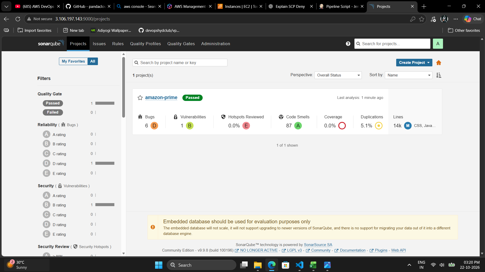
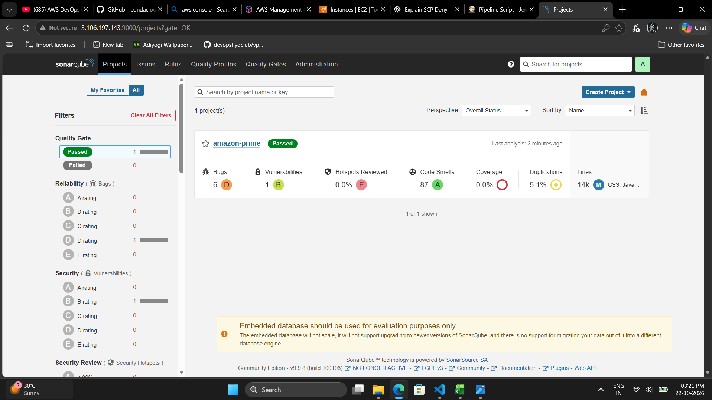
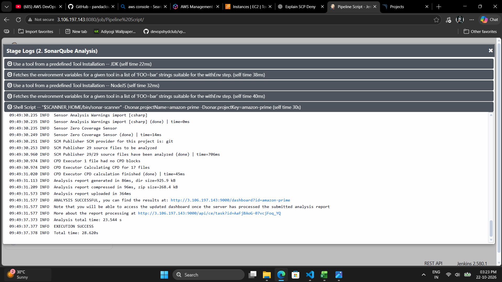
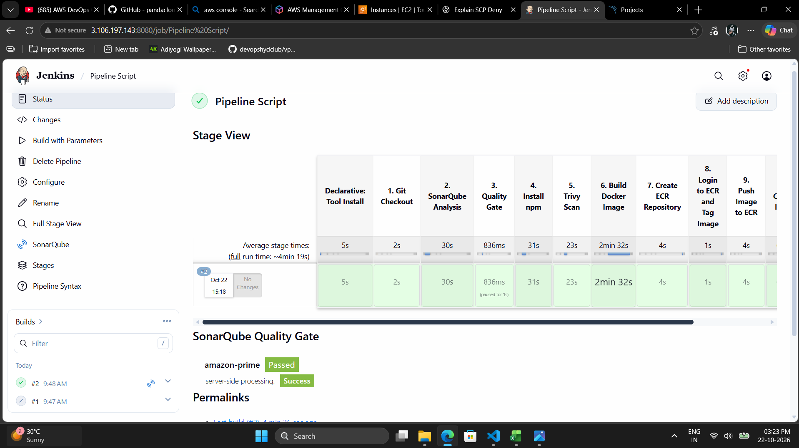
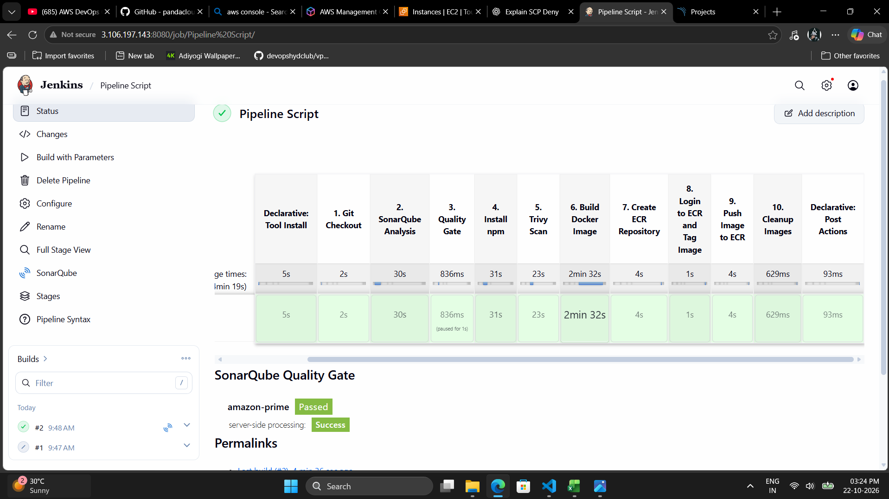
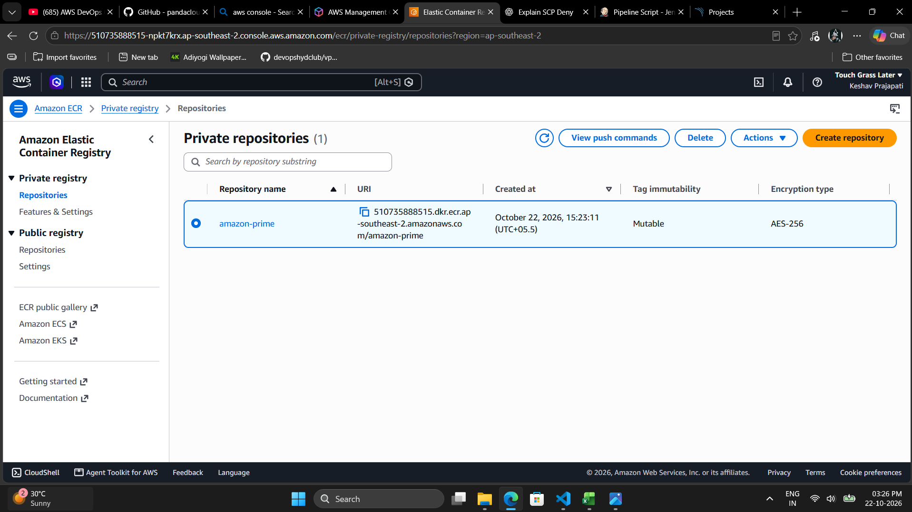
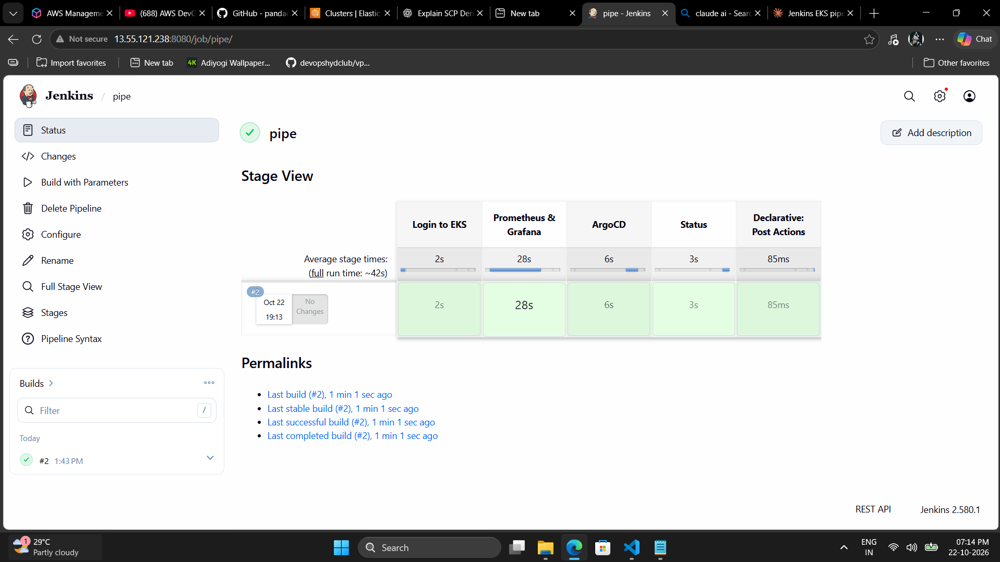

### Cluster Setup Pipeline (Monitoring + ArgoCD)
Create a second Jenkins pipeline with the script below. It logs in to EKS, installs Prometheus & Grafana with Helm, and installs ArgoCD.

```groovy
pipeline {
    agent any

    options {
        timeout(time: 20, unit: 'MINUTES')
        timestamps()
    }

    parameters {
        string(name: 'CLUSTER_NAME', defaultValue: 'amazon-prime-cluster', description: 'EKS cluster name')
        string(name: 'AWS_REGION', defaultValue: 'ap-southeast-2', description: 'AWS region of the cluster (Sydney)')
        string(name: 'ARGOCD_VERSION', defaultValue: 'stable', description: 'ArgoCD manifest ref (use a tag like v2.x.y to pin)')
        string(name: 'PROM_CHART_VERSION', defaultValue: '', description: 'kube-prometheus-stack chart version (empty = latest)')
    }

    environment {
        AWS_ACCOUNT_ID        = '<YOUR_AWS_ACCOUNT_ID>'
        AWS_ACCESS_KEY_ID     = credentials('access-key')
        AWS_SECRET_ACCESS_KEY = credentials('secret-key')
        // Fallbacks so the first build after adding parameters still works
        REGION                = "${params.AWS_REGION ?: 'ap-southeast-2'}"
        ARGOCD_REF            = "${params.ARGOCD_VERSION ?: 'stable'}"
    }

    stages {
        stage('Login to EKS') {
            steps {
                sh '''
                    set -e
                    ACTUAL_ACCOUNT=$(aws sts get-caller-identity --query Account --output text)
                    if [ "$ACTUAL_ACCOUNT" != "$AWS_ACCOUNT_ID" ]; then
                        echo "Credentials belong to account $ACTUAL_ACCOUNT, expected $AWS_ACCOUNT_ID"
                        exit 1
                    fi
                    aws eks --region "$REGION" update-kubeconfig --name "$CLUSTER_NAME"
                    kubectl get nodes
                '''
            }
        }

        stage('Prometheus & Grafana') {
            steps {
                sh '''
                    set -e
                    helm repo add prometheus-community https://prometheus-community.github.io/helm-charts || true
                    helm repo update

                    # Clear a release left stuck by an aborted or failed earlier run
                    if helm status stable -n prometheus 2>/dev/null | grep -Eq 'STATUS: (pending|failed)'; then
                        echo "Removing stuck release 'stable'"
                        helm uninstall stable -n prometheus
                    fi

                    VERSION_FLAG=""
                    if [ -n "${PROM_CHART_VERSION}" ]; then VERSION_FLAG="--version ${PROM_CHART_VERSION}"; fi

                    helm upgrade --install stable prometheus-community/kube-prometheus-stack \
                        -n prometheus --create-namespace $VERSION_FLAG

                    kubectl patch svc stable-kube-prometheus-sta-prometheus -n prometheus -p '{"spec": {"type": "LoadBalancer"}}'
                    kubectl patch svc stable-grafana -n prometheus -p '{"spec": {"type": "LoadBalancer"}}'
                '''
            }
        }

        stage('ArgoCD') {
            steps {
                sh '''
                    set -e
                    kubectl create namespace argocd || true
                    kubectl apply --server-side --force-conflicts -n argocd -f "https://raw.githubusercontent.com/argoproj/argo-cd/${ARGOCD_REF}/manifests/install.yaml"
                    kubectl patch svc argocd-server -n argocd -p '{"spec": {"type": "LoadBalancer"}}'
                '''
            }
        }

        stage('Status') {
            steps {
                sh '''
                    kubectl get pods -n prometheus || true
                    kubectl get pods -n argocd || true
                    kubectl get svc -n prometheus | grep -i loadbalancer || true
                    kubectl get svc -n argocd | grep -i loadbalancer || true
                '''
            }
        }
    }

    post {
        success {
            echo 'Applied. Pods take a few minutes to become Ready and load balancer hostnames 2-3 minutes to appear.'
        }
        failure {
            echo 'Pipeline failed: check the stage logs above.'
        }
    }
}
```

**Proof – EKS cluster, nodes and pods running:**

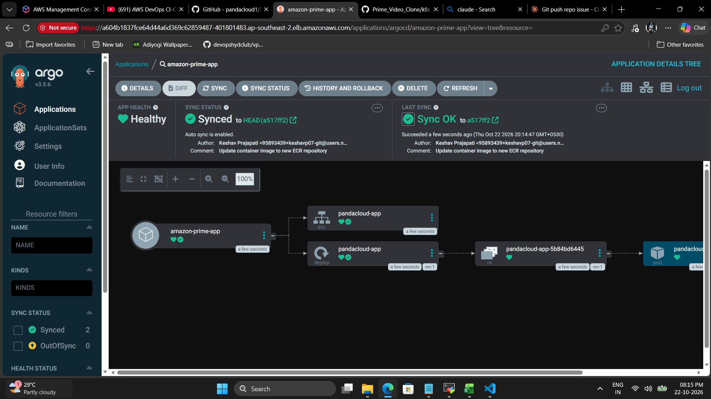
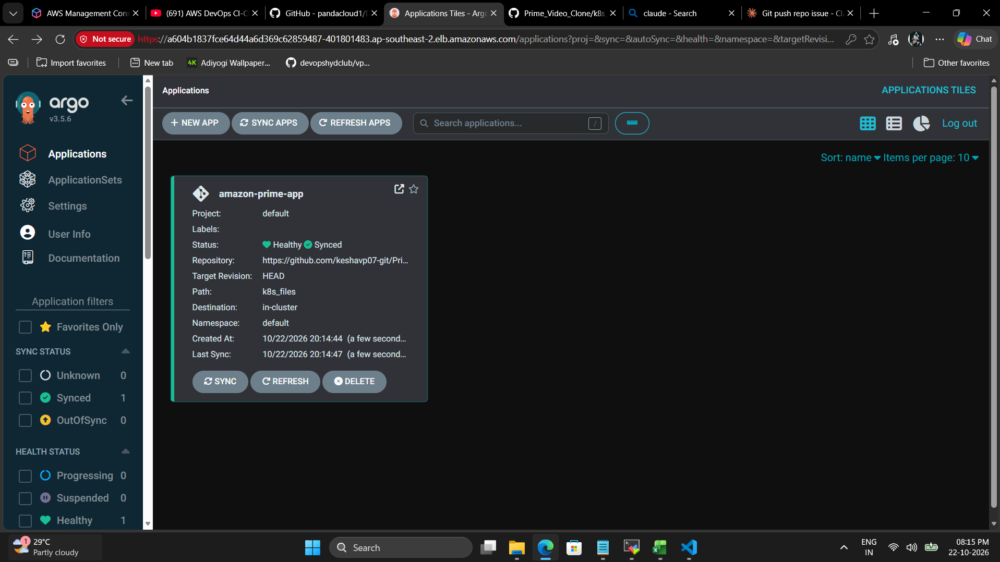
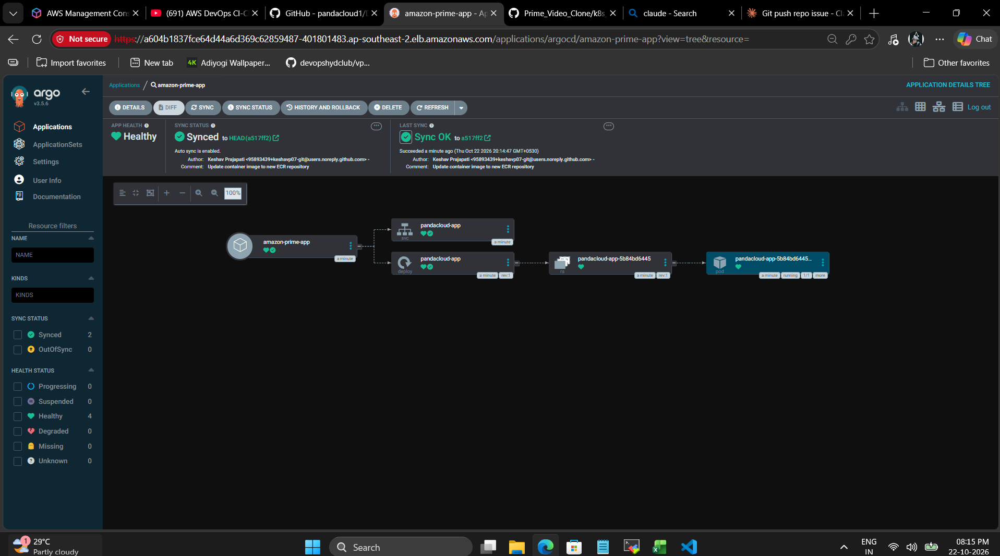

## Continuous Deployment with ArgoCD
1. **Create EKS Cluster**: Use Terraform to create an EKS cluster and related resources.
2. **Deploy Amazon Prime Clone**: Use ArgoCD to deploy the application using the Kubernetes YAML files in [`k8s_files`](./k8s_files).
3. **Monitoring Setup**: Install Prometheus and Grafana using Helm charts to monitor the Kubernetes cluster.

**Proof – ArgoCD application synced and healthy:**

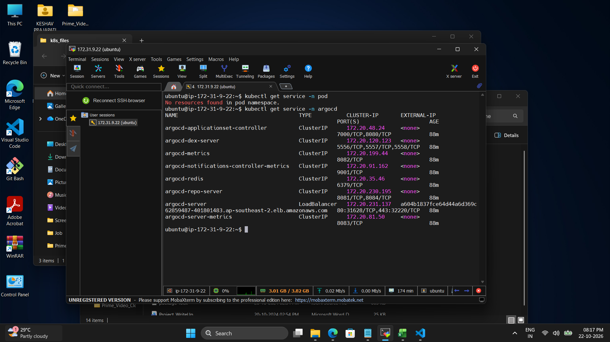
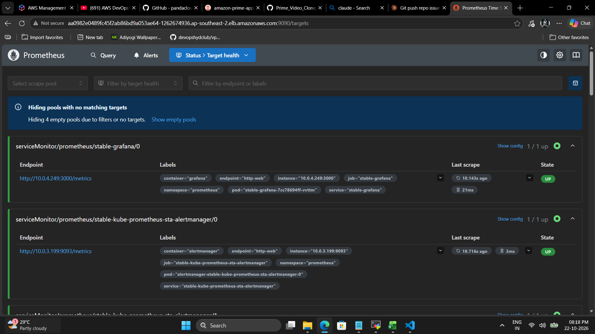
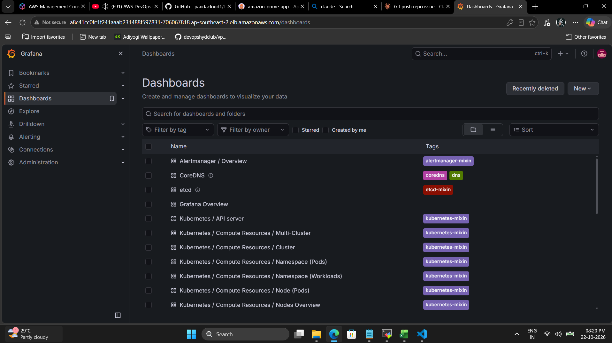

## Application Output
The Amazon Prime clone is running on EKS and reachable through the load balancer URL.

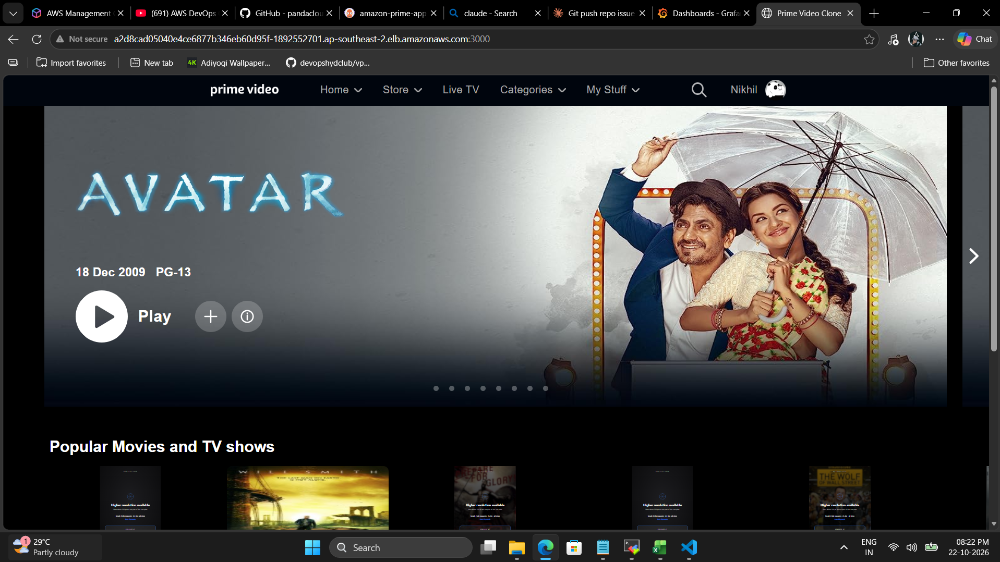

## Monitoring with Prometheus & Grafana
Grafana dashboards show live cluster metrics (CPU, memory, pods, network) collected by Prometheus.

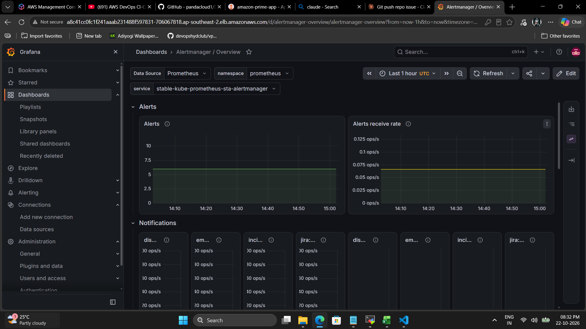
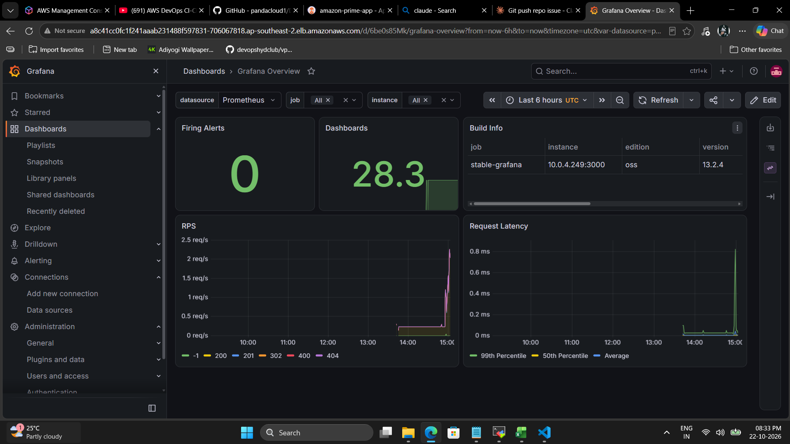
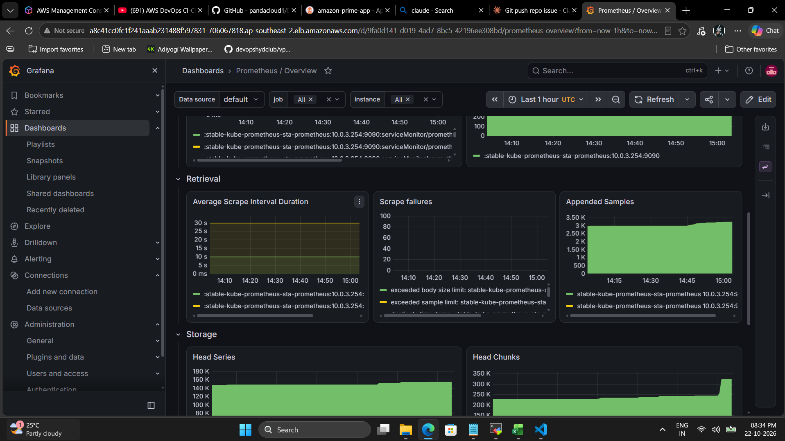
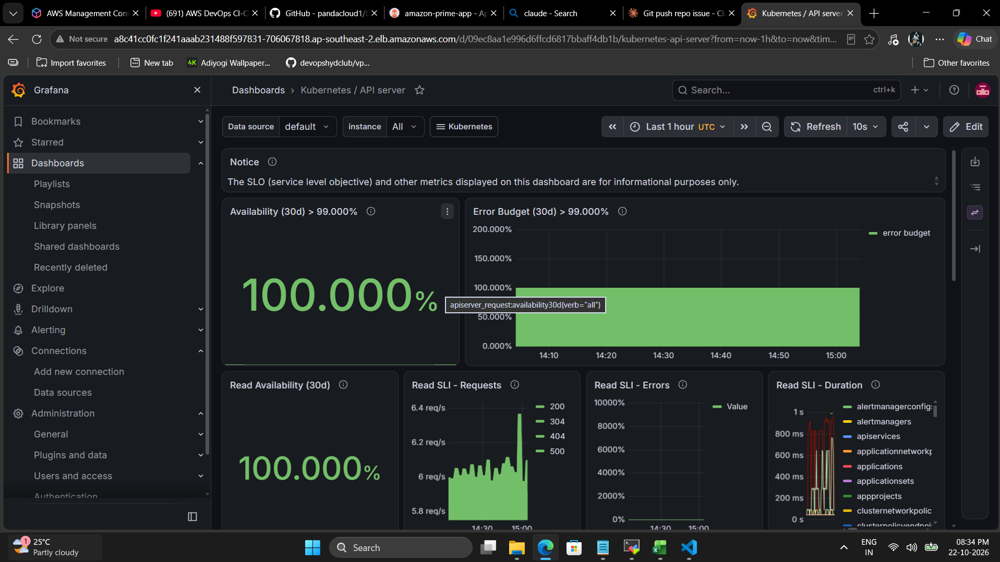

## Cleanup
- Run the cleanup pipeline to delete resources such as load balancers, services, and deployments.
- Use `terraform destroy` to remove the EKS cluster and other infrastructure.

### Cleanup Pipeline
```groovy
pipeline {
    agent any

    environment {
        AWS_REGION     = 'ap-southeast-2'
        AWS_ACCOUNT_ID = '<YOUR_AWS_ACCOUNT_ID>'
        KUBECTL        = '/usr/local/bin/kubectl'
    }

    parameters {
        string(
            name: 'CLUSTER_NAME',
            defaultValue: 'amazon-prime-cluster',
            description: 'EKS cluster name in the new AWS account'
        )

        string(
            name: 'ECR_REPO_NAME',
            defaultValue: 'amazon-prime',
            description: 'ECR repository to delete'
        )

        booleanParam(
            name: 'DELETE_KMS_KEYS',
            defaultValue: false,
            description: 'Schedule explicitly listed KMS keys for deletion'
        )

        string(
            name: 'KMS_KEY_IDS',
            defaultValue: '',
            description: 'Comma-separated KMS key IDs. Leave empty unless verified.'
        )
    }

    stages {
        stage('1. Verify AWS Account and Login to EKS') {
            steps {
                withCredentials([
                    string(credentialsId: 'access-key',
                           variable: 'AWS_ACCESS_KEY_ID'),
                    string(credentialsId: 'secret-key',
                           variable: 'AWS_SECRET_ACCESS_KEY')
                ]) {
                    sh '''
                        set -eu
                        export AWS_DEFAULT_REGION="$AWS_REGION"
                        export AWS_PAGER=""

                        ACTUAL_ACCOUNT=$(aws sts get-caller-identity \
                            --query Account --output text)

                        echo "Authenticated AWS account: $ACTUAL_ACCOUNT"

                        if [ "$ACTUAL_ACCOUNT" != "$AWS_ACCOUNT_ID" ]; then
                            echo "ERROR: Expected AWS account $AWS_ACCOUNT_ID."
                            echo "No cleanup will proceed."
                            exit 1
                        fi

                        aws eks describe-cluster \
                            --name "$CLUSTER_NAME" \
                            --region "$AWS_REGION"

                        aws eks update-kubeconfig \
                            --region "$AWS_REGION" \
                            --name "$CLUSTER_NAME"

                        kubectl get nodes
                    '''
                }
            }
        }

        stage('2. Cleanup Kubernetes Resources') {
            steps {
                input message: 'Confirm deletion of the selected Kubernetes resources in the new AWS account?', ok: 'Confirm Cleanup'

                sh '''
                    set -eu

                    kubectl delete deployment pandacloud-app \
                        --ignore-not-found=true

                    kubectl delete service pandacloud-app \
                        --ignore-not-found=true

                    # Delete Argo CD resources only if the namespace exists.
                    if kubectl get namespace argocd >/dev/null 2>&1; then
                        kubectl delete -n argocd \
                            -f https://raw.githubusercontent.com/argoproj/argo-cd/stable/manifests/install.yaml \
                            --ignore-not-found=true || true

                        kubectl delete namespace argocd \
                            --ignore-not-found=true
                    fi

                    # Uninstall the specified Helm release if present.
                    if helm status stable -n prometheus >/dev/null 2>&1; then
                        helm uninstall stable -n prometheus
                    fi

                    if kubectl get namespace prometheus >/dev/null 2>&1; then
                        kubectl delete namespace prometheus \
                            --ignore-not-found=true
                    fi

                    # Remove local Helm repository entries if present.
                    helm repo remove stable 2>/dev/null || true
                    helm repo remove prometheus-community 2>/dev/null || true
                '''
            }
        }

        stage('3. Delete ECR Repository') {
            steps {
                input message: 'Confirm permanent deletion of this ECR repository and all its images?', ok: 'Delete ECR Repository'

                withCredentials([
                    string(credentialsId: 'access-key',
                           variable: 'AWS_ACCESS_KEY_ID'),
                    string(credentialsId: 'secret-key',
                           variable: 'AWS_SECRET_ACCESS_KEY')
                ]) {
                    sh '''
                        set -eu
                        export AWS_DEFAULT_REGION="$AWS_REGION"
                        export AWS_PAGER=""

                        ACTUAL_ACCOUNT=$(aws sts get-caller-identity \
                            --query Account --output text)

                        if [ "$ACTUAL_ACCOUNT" != "$AWS_ACCOUNT_ID" ]; then
                            echo "ERROR: Wrong AWS account. Aborting."
                            exit 1
                        fi

                        aws ecr describe-repositories \
                            --registry-id "$AWS_ACCOUNT_ID" \
                            --repository-names "$ECR_REPO_NAME" \
                            --region "$AWS_REGION"

                        aws ecr delete-repository \
                            --registry-id "$AWS_ACCOUNT_ID" \
                            --repository-name "$ECR_REPO_NAME" \
                            --region "$AWS_REGION" \
                            --force
                    '''
                }
            }
        }

        stage('4. Schedule Selected KMS Keys for Deletion') {
            when {
                expression { params.DELETE_KMS_KEYS }
            }
            steps {
                input message: 'Confirm scheduling the specified KMS keys for deletion after a 30-day waiting period?', ok: 'Schedule KMS Deletion'

                withCredentials([
                    string(credentialsId: 'access-key',
                           variable: 'AWS_ACCESS_KEY_ID'),
                    string(credentialsId: 'secret-key',
                           variable: 'AWS_SECRET_ACCESS_KEY')
                ]) {
                    sh '''
                        set -eu
                        export AWS_DEFAULT_REGION="$AWS_REGION"
                        export AWS_PAGER=""

                        ACTUAL_ACCOUNT=$(aws sts get-caller-identity \
                            --query Account --output text)

                        if [ "$ACTUAL_ACCOUNT" != "$AWS_ACCOUNT_ID" ]; then
                            echo "ERROR: Wrong AWS account. Aborting."
                            exit 1
                        fi

                        if [ -z "$KMS_KEY_IDS" ]; then
                            echo "ERROR: No KMS key IDs supplied."
                            exit 1
                        fi

                        OLD_IFS="$IFS"
                        IFS=','
                        set -- $KMS_KEY_IDS
                        IFS="$OLD_IFS"

                        for key in "$@"; do
                            key=$(printf '%s' "$key" | xargs)

                            [ -n "$key" ] || continue

                            echo "Checking KMS key: $key"

                            KEY_ACCOUNT=$(aws kms describe-key \
                                --key-id "$key" \
                                --region "$AWS_REGION" \
                                --query 'KeyMetadata.AWSAccountId' \
                                --output text)

                            KEY_MANAGER=$(aws kms describe-key \
                                --key-id "$key" \
                                --region "$AWS_REGION" \
                                --query 'KeyMetadata.KeyManager' \
                                --output text)

                            if [ "$KEY_ACCOUNT" != "$AWS_ACCOUNT_ID" ]; then
                                echo "ERROR: Key $key belongs to another account."
                                exit 1
                            fi

                            if [ "$KEY_MANAGER" != "CUSTOMER" ]; then
                                echo "ERROR: Key $key is not customer-managed."
                                exit 1
                            fi

                            aws kms schedule-key-deletion \
                                --key-id "$key" \
                                --pending-window-in-days 30 \
                                --region "$AWS_REGION"
                        done
                    '''
                }
            }
        }
    }

    post {
        success {
            echo 'Cleanup pipeline completed successfully.'
        }
        failure {
            echo 'Cleanup pipeline failed or was interrupted. Review the console output and AWS resources.'
        }
        always {
            echo 'Review all deletion results before considering cleanup complete.'
        }
    }
}
```

## Additional Information
For further details, refer to `Project_WriteUp.docx`, which contains a complete write-up of the project.